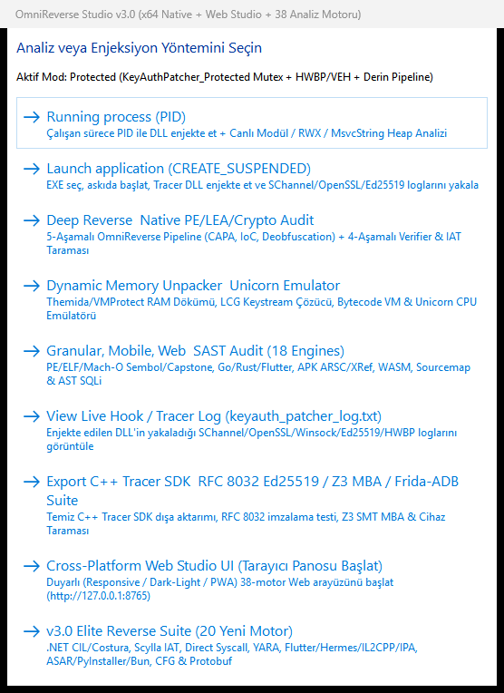

# OmniReverse Studio v3.2

[]()
[]()
[](https://www.python.org/)
[](LICENSE)
[]()

> **OmniReverse Studio**, korumalı Windows `.exe` dosyalarını, DLL'leri ve ikili dosyaları incelemek için geliştirilmiş hafif, hızlı ve bağımsız (standalone) bir tersine mühendislik ve analiz aracıdır.

---

## 📸 Program İçi Arayüz (Win32 Native GUI)

<p align="center">
  
</p>

---

## ⚡ Ne İşe Yarar? (Öne Çıkan Özellikler)

Korumalı bir programı kurcalarken veya şüpheli bir hileyi/yazılımı incelerken her seferinde IDA, Ghidra ya da x64dbg açmak hantal gelebiliyor. OmniReverse Studio, en sık ihtiyaç duyulan analizleri tek çatıda toplar:

* **🔍 PE & Entropi Analizi:** Dosyanın Entry Point, section yapıları ve entropi oranlarını döker. Dosyada packer/koruma (**UPX, VMProtect, Themida** vb.) olup olmadığını saniyeler içinde gösterir.
* **🧵 Canlı String & Bellek Tarama:** Dosya ya da süreç belleğindeki tüm ASCII/Unicode stringleri filtreler. Gizlenmiş **C2 IP'leri, Discord webhookları, API anahtarları veya lisans sorguları** tek tıkla ayıklanır.
* **💉 DLL Enjeksiyon & IAT Listesi:** Çalışan sürece (PID ile) veya askıda başlatılan (`CREATE_SUSPENDED`) uygulamaya analiz modülü enjekte eder; Import/Export adreslerini ve çağrılan API fonksiyonlarını döker.
* **📦 Modern Paket Parçalayıcı (Unpacker):** Yalnızca klasik PE'leri değil; **Electron (`.asar`)**, **PyInstaller (`.pyz`)**, **Flutter AOT** ve **Unity (`IL2CPP`)** dosyalarını da tanır ve ayıklar.
* **🧩 Hex & Disassembly Önizleyici:** Hızlı opcode kontrolü ve byte seviyesinde ikili inceleme için dahili hex/disasm önizlemesi.

---

## 🚀 Kullanım

### 1. Standalone Windows GUI (En Kolayı)
Herhangi bir kurulum, Python veya ek paket gerekmez.

1. `OmniReverse_Studio.exe` dosyasını sağ tıklayıp **Yönetici Olarak Çalıştırın**.
2. Açılan menüden incelemek istediğiniz modu (Protected / Non-Protected) seçin.
3. Hedef dosyayı veya çalışan sürecin PID'sini girerek analizi başlatın.

### 2. Komut Satırı & Otomatik HTML Raporu (CLI)
Dosyayı komut satırından derinlemesine tarayıp tek sayfa karanlık temalı HTML raporu almak için:

```bash
# Bağımlılıkları yükleyin
pip install -r requirements.txt

# Hızlı analiz ve HTML raporu çıktısı
python omni_cli_runner.py hedef_dosya.exe --export-html analiz_raporu.html

# PyInstaller / Electron ASAR paketini ayıklama
python omni_cli_runner.py program.asar --mode unpack
```

### 3. C++ Kaynak Kodundan Derleme
Projeyi kendi ortamınızda sıfırdan derlemek isterseniz:

```cmd
cd native_app
build_native.bat
```

---

## 🌐 English Summary & Architecture

OmniReverse Studio provides a unified multi-engine static and dynamic reverse engineering environment for Windows x64. It combines PE parsing, memory forensic scanning, symbolic constraint analysis (Z3 SMT), and package extraction into a lightweight native binary.

### Key Capabilities
- **Static Triage:** Header, section entropy, rich header hash, and compiler detection.
- **Dynamic Tracer:** Hardware breakpoints (DR0–DR3), VEH context hooking, and memory scanning.
- **Packers & Runtimes:** Unpack support for Electron ASAR, PyInstaller PYZ, Hermes HBC, and Flutter AOT.
- **MCP Server Support:** Native Model Context Protocol (MCP) server via `omni_server.py` for AI agent integration.

---

## 🧪 Test & Doğrulama

Tüm motorlar ve ayrıştırma rutinleri `pytest` ile test edilmiştir:

```bash
python -m pytest tests/ -v
```

---

## 📄 Lisans

Bu proje [MIT Lisansı](LICENSE) altında açık kaynak olarak sunulmaktadır. Eğitim ve savunma odaklı güvenlik araştırmaları için hazırlanmıştır.
